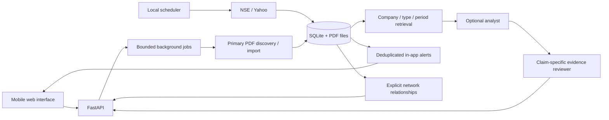

# FINN

A mobile-first investment desk: **portfolio event → source evidence → relevant contact**. FastAPI, SQLite/FTS5 and plain JavaScript; real archived filings and clearly labelled synthetic contacts.

The local prototype has four annual reports, eight transcripts and twelve archived filings. All eighteen price feeds refreshed successfully; the official Reliance announcement fallback imported ten filings and created five alerts. Research with `gpt-4o-mini` plus the `gpt-6.1-sol` reviewer passed 12/12 structural checks; source inspection checked 41 retained findings and matched all 67 supporting spans to original PDFs. Chrome checks passed at 1440px and 390px. **Research answers still have coverage limits, live announcements cover only Reliance, and hosting/publication remain unfinished.** See [VERIFICATION.md](VERIFICATION.md).

## Run

From this directory with Python 3.12 or newer:

```sh
python3 -m venv .venv
source .venv/bin/activate
pip install -r requirements.txt
python3 -m uvicorn app:app --host 127.0.0.1 --port 8000 --workers 1
```

Open **http://127.0.0.1:8000**; API documentation is at `/docs`. The prepared submission archive includes 24 public PDFs and a portable search index: twelve archived filings under `demo_documents/`, plus four annual reports and eight transcripts under `demo_primary/`. A fresh workspace installs the public index without overwriting an existing database; clean-extraction startup and PDF access passed. The source workspace can also extract archived filings from `../CS787-main/company_assets`. Original CS787 files remain unchanged.

No API key is needed for archive exploration, PDF retrieval, numerical comparisons, contact matching, imports or alerts. For AI analysis, copy `.env.example` to `.env` **only if you do not already have a configured `.env`**, set `OPENAI_API_KEY`, and restart. Exported environment variables take precedence. Never commit the key. The default `FINN_MODEL` is `gpt-4o-mini`; it is configurable, not a claim about the latest or best model.

The source-reviewed evaluation used a separate reviewer. To run that same configuration:

```sh
FINN_REVIEW_MODEL=gpt-6.1-sol python3 -m uvicorn app:app --host 127.0.0.1 --port 8000 --workers 1
```

You can instead set `FINN_REVIEW_MODEL=gpt-6.1-sol` in your existing `.env`. This changes reviewer usage/cost; it has not been silently applied to your credentials file. With no separate reviewer configured, both passes use `FINN_MODEL`; earlier mini-only results failed source review despite structural passes.

## Try the working archive journey

1. Briefing defaults to **Live / 24 hours**. Inspect source health, then select **Archive** for the supplied historical examples.
2. Open Reliance’s **Profit growth deserves a closer look**. Compare Revenue, EBITDA, PBT and PAT, then open the original PDF page. This parser is limited to that reviewed consolidated Q1 FY26 table.
3. Inspect the investment-sale disclosure and Ananya’s relevant experience. Select **Ask about this filing** and trace each passage to its original page.
4. In Network, search `IT Services`, `credit risk` or `semiconductors`. Kavya’s introduction path is explicitly **You → Rohan Shah → Kavya Rao**.
5. Save an event, change watched categories/thresholds, inspect the alerts dialog, and review the monitoring status. Monitoring pauses when the backend stops.

## Populate and verify the primary research library

```sh
python3 manage.py status
# Run acquisition, AI smoke, feed refresh and evaluation in sequence:
python3 manage.py verify --include-historical
python3 manage.py prepare
# Optional: also import clearly dated, verified historical fallback transcripts.
python3 manage.py prepare --include-historical
python3 manage.py smoke-ai
python3 manage.py refresh
FINN_REVIEW_MODEL=gpt-6.1-sol python3 manage.py evaluate
```

These commands write reports to private `data/verification/`. Failed or incomplete acceptance checks return nonzero. `evaluate` asks three questions each of TCS, Infosys, Reliance and Asian Paints; passing structural checks still requires manual claim-by-claim inspection.

[examples/primary_sources.json](examples/primary_sources.json) contains twelve latest targets and six historical fallbacks. Web inspection verified six latest PDF identities; six BSE transcript links returned 403 and require review. The preparation command only downloads content-verified entries, checks the downloaded identity/type/year, preserves provenance and indexes the original PDF pages. A discovery listing date is **never** used as a reporting period: one observed TCS row labelled July 2026 linked to a July 2025 transcript.

Research → **Find annual reports & transcripts** supports any NSE ticker with available source pages. Open each PDF, confirm company/type/period, then import. For inaccessible sources, use the original company's IR site or manually upload a lawfully obtained text-searchable PDF (up to 100 MB for annual reports; 25 MB for transcripts and filings). The interface shows missing coverage, provenance and periods. Filings remain a separate research scope; they are never silently substituted for annual reports/transcripts.

If the backend cannot download PDFs, obtain them through your browser using the official manifest links. Place verified documents in an inbox with names such as `TCS-annual_report-FY2026.pdf` or `ASIANPAINT-transcript-Q2-FY2026.pdf`, then run:

```sh
python3 manage.py prepare --include-historical --local-dir data/inbox
```

This mode makes no network requests. Missing files and unverified candidates stay missing; reporting periods are never inferred from filenames. The report lists each expected `local_filename`. Local files are checked against the reviewed manifest, and their verification label identifies the local import route. Real AI calls and live feeds still require network access.

[Discovery evidence and official links](docs/SOURCE_DISCOVERY.md) explain what was inspected and what remains missing.

## What is implemented

- Four responsive views: Briefing, Research, Network and Portfolio; saved/read states and explicit archive/live windows.
- Eighteen-company mock portfolio. `TMPV` replaces stale `TATAMOTORS`; migration preserves historical records under the old symbol. `TMCV` is a separate commercial-vehicles company, not an alias for historical evidence. [NSE symbol circular](https://nsearchives.nseindia.com/content/circulars/CML70875.pdf).
- PDF upload and public HTTPS import; page-preserving chunks, content deduplication, strict company/type/period retrieval and source links. Retrieval expands common research questions, removes near-duplicate passages and distributes evidence across documents.
- Bounded analyst → reviewer pipeline using the [OpenAI Responses API](https://developers.openai.com/api/docs/guides/structured-outputs). Every finding needs valid citation IDs; each reviewer claim includes only its cited passages. Invalid output fails back to evidence. Diagnostics distinguish connectivity, authentication, quota, access, timeouts and validation. Cache keys include exact evidence, source metadata, model and pipeline version. Token usage and latency are recorded when available.
- NSE date-range announcement adapter, configurable official-company fallback and Yahoo end-of-day adapter, with persisted refresh history and deduplication. NSE returned HTTP 403 in live testing; the fallback successfully covered Reliance only (1/18 companies) and reports partial coverage. Date-only announcements explicitly show that publication time is unknown. Prices exclude incomplete/future sessions; volume uses the preceding twenty sessions. Split-affected windows do not generate threshold alerts.
- A single local scheduler checks announcements every fifteen minutes and completed-session prices after 16:00 Asia/Kolkata. Persistent in-app alerts are unique per event/session and link to research/contacts. Failed market refreshes cannot alert on stale cached prices. Browser badges poll every thirty seconds; no email or device notifications are sent.
- Validated JSON contact import, multiple employers with dates, expertise, education, explicit introduction paths and no-match responses. Use [examples/contacts.json](examples/contacts.json) to replace or merge a network. Employment overlap alone does not invent a relationship.
- Additive, versioned SQLite migrations preserve saved events, uploads and settings. Imported contacts are not overwritten by startup seeding.

## Architecture, privacy and costs



At most two model calls per uncached research request, with no multi-round debate and `store=False`. Only the question and selected primary-source passages are sent; profiles are not sent to the model. Evidence mode and cached answers require no new model call. The latest batch had eleven uncached answers using 100,139 analyst tokens and 86,660 reviewer tokens, with observed request latency of about 9.5–23.2 seconds; one answer was cached. These are measured token counts, not a billing claim. See [research evaluation](docs/EVALUATION.md) for quality limits.

All data stays in `data/` or `FINN_DATA_DIR`. Local documents, contacts, jobs, alerts, cached outputs and verification reports persist until removed by the workspace owner. This is a single-investor prototype with a same-origin write guard, **not** a multi-user authenticated service. Use synthetic data and an access gate before exposing it beyond the local machine. [Deployment and retention notes](docs/DEPLOYMENT.md) distinguish existing controls from production work.

Inspired by **CS787 AlphaAgents**, by Aamir Ahmad, Aaryan Maheshwari, Aviral Gupta, Pallav Rastogi and Suyash Kapoor. Reused concepts include scoped tools, grounded analysis, deterministic numeric tools and critique before synthesis. FINN is separate code with a smaller pipeline; the original project and attribution are preserved. Archived company PDFs remain the property of their issuers.

## Check and package

```sh
FINN_DISABLE_MONITOR=1 python3 -m unittest discover -s tests -v
node --check static/app.js
python3 package_submission.py
```

`dist/finn-submission.zip` is an allowlisted source bundle with 24 public PDFs, a generated public-only search index and a SHA-256 file manifest. It excludes `.env`, investor runtime databases/uploads, contacts, caches, alerts and personal verification reports. The bundled database contains only public documents, extracted text, company metadata and default settings. It does not publish to GitHub or deploy anything.

[Five-minute demo and phone QA checklist](docs/DEMO.md) · [Submission email draft](docs/SUBMISSION_EMAIL.md) · [Implementation plan](IMPLEMENTATION_PLAN.md).

## Remaining work

- Successfully download/index the annual reports and transcripts; resolve the six unverified current transcript candidates. Four annual reports and eight transcripts are indexed; six newer transcript candidates still require verification.
- The real analyst/reviewer filing smoke check passed. Evaluate and inspect at least nine fundamental-research answers plus the unseen ticker.
- Exercise live feeds successfully and validate all current portfolio symbols. A user-terminal run successfully refreshed all eighteen symbols; NSE announcements still failed access checks.
- Validate discovery parsing against downloaded live HTML. Its section/parser behavior is fixture-tested; the runtime fetch remains blocked.
- Complete real desktop/phone QA. No browser-control tool is available and local sockets are denied in this session.
- General table extraction, four-quarter promise tracking, OCR, management biographies and outbound alerts remain deferred.
- Build/test the container, deploy behind appropriate access controls, publish the repository, attach actual build-history exports and send the submission only when explicitly instructed.

The analyst and reviewer request JSON explicitly in their input payloads as well as their instructions, following the [official JSON-mode guidance](https://developers.openai.com/api/docs/guides/structured-outputs#json-mode). Annual-report downloads, local imports and uploads share a 100 MB cap; filings/transcripts share a 25 MB cap. PDF imports retain the 1,000-page cap.

The research pipeline now restores page context from stored chunks, requires supporting quotations matched to each claim’s own citations, and checks that numerical literals appear in those quotations or their reporting periods. These are conservative checks, not proof of semantic correctness. Source inspection found errors that the initial model reviewer missed; see [the evaluation record](docs/EVALUATION.md). The new pipeline uses a different cache version.

For diagnosis, `python3 manage.py evaluate --symbols TCS --question-index 3` evaluates just the cash-flow question for TCS. Evaluation files are archived automatically before replacement. The current pipeline also recognises fiscal ranges and PDF layout spacing; reviewer edits remain restricted to the draft’s own sources and are checked against supporting quotations.

The current reviewer uses [Structured Outputs](https://developers.openai.com/api/docs/guides/structured-outputs) with source IDs constrained to actual evidence. It selects numbered source lines; Python copies their text into the supporting quotations. This avoids invented example IDs and errors while retyping financial-table rows. Wrong-source and out-of-range references are still withheld and reported specifically.

## Official-company filing fallback

When NSE fails, FINN can read dated PDF links from configured official-company pages. `examples/announcement_sources.json` currently configures Reliance’s public IR page; other sources can be configured with FINN_ANNOUNCEMENT_SOURCES. A live 30-day refresh imported ten Reliance filings and created five alerts. This is partial coverage of one of eighteen companies, not an NSE success or a complete digest. Date-only entries are labelled with unknown publication time; their overlapping calendar days are included in selected windows. Source failures remain visible.

```sh
python3 manage.py refresh --days 30
```

## Reviewer selection and browser QA

`FINN_REVIEW_MODEL` configures the reviewer independently from FINN_MODEL. It defaults to the analyst model. A targeted gpt-6.1-sol reviewer run correctly rejected an unconfirmed analyst premise that the mini-only reviewer had accepted. Broader source review is still required. The [official model documentation](https://developers.openai.com/api/docs/models/gpt-6.1-sol) lists Responses, Structured Outputs and low reasoning effort support. The reviewer uses low effort and a bounded output budget for this model. A stronger reviewer has a higher per-call cost; test a targeted case first. No API key is changed by model selection.

```sh
FINN_REVIEW_MODEL=gpt-6.1-sol python3 manage.py evaluate --symbols ASIANPAINT --question-index 1
```

For browser verification, install the optional development dependency and use the existing Chrome installation:

```sh
python3 -m pip install -r requirements-dev.txt
python3 browser_qa.py
```

The runner starts a temporary local server against a database snapshot, disables model calls/monitoring, exercises desktop and 390px phone layouts and saves screenshots/report privately. It checks archive events, saved state, PDF access/upload, research evidence/progress/errors, contacts/imports, alerts and settings. Both widths passed twelve checks with no page errors; representative screenshots were inspected. It does not mutate the working database or validate live AI answers. Physical-device Safari and accessibility audits remain separate work.
