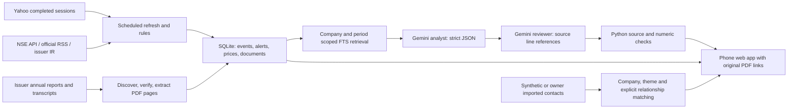

# How FINN fits together

FINN follows one investor workflow: notice a portfolio event, open its original document, then find someone who can help explain it. The four views share one FastAPI backend and one SQLite workspace. Plain JavaScript keeps the phone interface small and avoids a frontend build step.

## Sources and linking

The mock portfolio has eighteen NSE companies across sectors. Prices use completed trading sessions, with volume compared to the previous twenty sessions. Arithmetic and alert thresholds run in Python. A scheduler checks announcements every fifteen minutes and prices after 16:00 IST while the backend is awake. Refresh history, deduplication and an overlap guard prevent stale or repeated alerts.

Announcements retain their issuer, source URL and publication precision. The NSE date-range API has returned 403, so FINN also reads the official recent RSS feed and configured issuer IR pages. Their limited history is labelled partial; an empty digest does not prove complete coverage. Archive examples stay separate from the default live window.

For a new ticker, Screener or listing metadata helps locate the company and its documents. Research evidence itself comes from original issuer/exchange PDFs. Bounded downloads and redirects reject private network destinations. Company identity, document type and reporting period are checked before import; unsuccessful sources remain gaps. Manual import is available, but there is no OCR. Each indexed page retains its document, source, period and PDF-page link.

Contact JSON records contain roles, employer dates, expertise, education and explicit relationships. Matching explains why a person is relevant. A second-degree path requires recorded edges; shared employment alone never invents an introduction. The ten seeded contacts are synthetic. Real imports would come from the investor or another source they may legitimately use, rather than scraping LinkedIn.

## Where models are used

Only research synthesis uses a model. Retrieved annual-report/transcript pages are constrained by company, period and document type; analysis of a specific filing has a separate scope. Broker notes, news and model memory are excluded by retrieval and instructions.

Gemini 3.6 Flash drafts concise findings in a strict schema, then a separate request checks each finding against its own cited evidence. The reviewer selects source lines; Python validates bounds, copies the actual quotations, checks numerical literals and prunes unsupported references. Unsupported claims can be withheld. These checks do not establish completeness or guarantee correct financial interpretation, so findings link back to the PDF.

There is no open-ended planning agent or model tool-execution loop. Acquisition, refresh scheduling, prioritisation, contact matching and financial arithmetic are ordinary bounded code. FINN does not contact people or send notifications outside the app.

Gemini was selected for the user's no-payment deployment. The observed project limits are five requests per minute and twenty per day, so request starts are paced and answers are cached against exact evidence, question, periods, provider, both models and pipeline version. One hinted minute-limit cooldown and bounded transient-server retries are allowed. Daily quota exhaustion stops evaluation; there is no automatic paid-provider failover. The older OpenAI path requires explicit selection. Current acceptance evidence is in [EVALUATION.md](EVALUATION.md).

## Storage, privacy and access

SQLite/FTS5 stores indexed pages, companies, contacts, events, settings, prices, jobs, alerts and model cache entries. Original PDFs stay on the same workspace filesystem. Local data persists until the owner removes it; this prototype has no automatic retention/deletion policy. Runtime data, uploads, credentials, model caches and verification reports are excluded from the public repository. The bundled SQLite index contains only the reviewed public document corpus; startup adds clearly synthetic demo contacts/events.

Contact profiles are never included in model requests. Questions and selected document passages are sent to Google; free-tier inputs/outputs may be used for product improvement under Google's terms. That is a material limit for confidential questions or uploads. Production would need an appropriate provider/data agreement, explicit consent, retention limits and audit records.

The hosted demo uses a shared HTTP Basic gate over HTTPS, with credentials in Render's secret environment. It protects the shared UI, APIs and original PDFs; `/healthz` exposes only minimal readiness. It does not isolate multiple investors. A production design needs individual authentication, workspace ownership on every query/file, consented imports, export/deletion, encrypted durable storage and access auditing.

## Why Render Free

One Docker web service runs FastAPI, the job workers and scheduler. SQLite avoids extra infrastructure for this prototype. No paid disk is attached. The free instance can sleep and its temporary runtime files can reset; the bundled public corpus restores, but extra downloads, imports, settings, alerts and model caches may be lost. Monitoring pauses while it sleeps. The UI displays this limitation.

The next version would separate scheduled ingestion from the web process, move investor data and files to durable storage, add per-investor ownership and improve source coverage/OCR before adding more research output types. The working prototype deliberately leaves out a general financial-table extractor, four-quarter promise tracker, executive biography scraper and outbound notifications. See [DEPLOYMENT.md](DEPLOYMENT.md) for the actual hosting setup.
